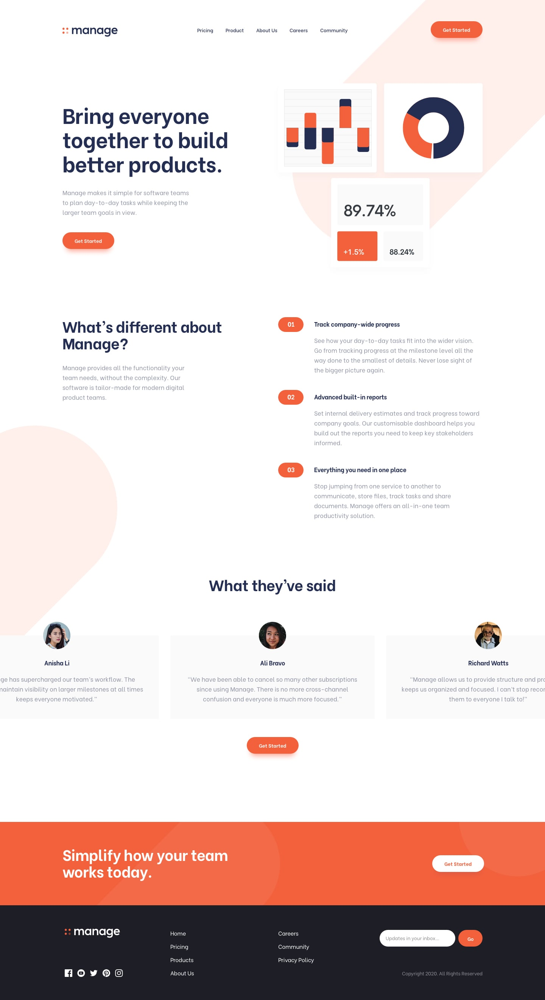
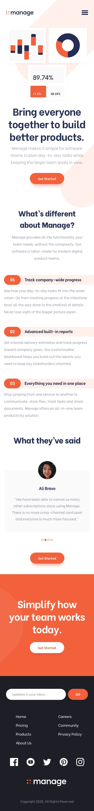

# Manage Landing Page

A responsive landing page for Manage, built with React, TypeScript, Vite, and Tailwind CSS.

## Getting started

Install dependencies:

```sh
npm install
```

Start the development server:

```sh
npm run dev
```

## Available scripts

| Command           | Description                                                      |
| ----------------- | ---------------------------------------------------------------- |
| `npm run dev`     | Start the local development server.                              |
| `npm run build`   | Type-check the project and create a production build in `dist/`. |
| `npm run preview` | Preview the production build locally.                            |
| `npm run lint`    | Run ESLint.                                                      |

## Features

- Responsive landing page with product, about, careers, and testimonial sections.
- Header and footer navigation links to sections on the same page.
- Footer email field with client-side validation.

The email form validates an address in the browser only; it does not submit or store it.

## Project structure

```text
src/
  assets/       Images, icons, and background illustrations
  components/   Page sections and shared UI
  App.tsx       Landing page composition
  main.tsx      React entry point
```

## Design reference

### desktop design


<br>

### mobile design


